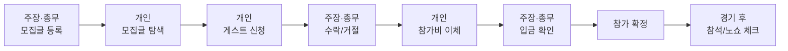

# 화면 흐름 스케치 (1단계)

기획서 v3 기준. 화면 디자인이 아니라 **누가 어떤 순서로 무엇을 하는지**만 정리한 문서입니다.

## 1. 큰 흐름

## 2. 화면 목록

| # | 화면 | 누가 | 핵심 내용 |
|---|---|---|---|
| 1 | 시작·로그인 | 모두 | 가입, 역할 선택(개인 / 주장·총무) |
| 2 | 내 정보 | 개인 | 키, 포지션, 기본 이동수단(대중교통/자차), 출발 지역·역 |
| 3 | 팀 등록 | 주장·총무 | 팀 이름, 지역, 실력 수준, 주 활동 시간·장소, 팀원 7명 이상 등록 (모집글 후 7일 안) |
| 4 | 모집글 등록 | 주장·총무 | 날짜·시간, 장소, 필요 인원, 실력 수준, 참가비, 입금 계좌, 취소 규칙 안내 |
| 5 | 모집글 목록 | 개인 | 내 이동수단 기준 30분 안팎 필터, 날짜 필터, 카드(날짜·장소·참가비·남은 자리) |
| 6 | 모집글 상세 | 개인 | 팀 정보, 시간·장소, 참가비, 취소 규칙(1시간 전까지), 신청 버튼 |
| 7 | 신청하기 | 개인 | 키·포지션 확인(내 정보에서 자동), 한 줄 메모, 신청 |
| 8 | 신청자 관리 | 주장·총무 | 신청자 목록(키·포지션), 수락/거절 |
| 9 | 입금 안내 | 개인 | 수락 알림 → 계좌·금액 확인, 이체 후 "입금했어요" |
| 10 | 입금 확인 | 주장·총무 | 입금 대기 목록, 확인 누르면 참가 확정 |
| 11 | 내 일정 | 개인 | 확정·대기 중인 경기, 1시간 전까지 취소 버튼 |
| 12 | 참석 체크 | 주장·총무 | 경기 후 게스트별 참석/노쇼 체크 |

## 3. 상태 (신청 하나가 거치는 단계)

신청됨 → 수락됨(입금 대기) → 입금 확인됨(참가 확정) → 참석 / 노쇼
(중간에 거절됨, 취소됨(1시간 전까지 → 환불 / 이후 → 환불 불가))

## 4. 알림이 필요한 순간
- 개인: 수락·거절됨, 참가 확정됨, 경기 전 알림
- 주장·총무: 새 신청, "입금했어요", 팀 등록 기한(7일) 임박

## 5. 정해야 할 것 (화면을 그리기 전)
1. 개인 계정과 주장·총무 계정을 나눌지, 한 계정에서 역할을 바꿀지
2. 로그인 방식 (카카오 로그인 등)
3. 알림 방식 (앱 푸시, 카카오 알림톡, 문자)
4. "입금했어요" 단계가 필요한지, 주장이 계좌 내역만 보고 확인하게 할지
